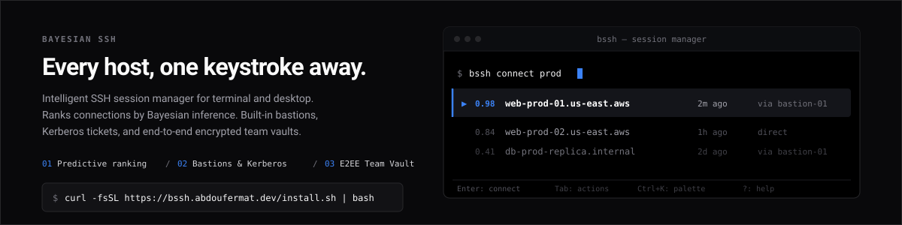

<p align="center">
  
</p>

# Bayesian SSH

[](LICENSE)
[](https://github.com/abdoufermat5/bayesian-ssh/actions/workflows/ci.yml)
[](https://bssh.abdoufermat.dev)

An SSH session manager for the terminal and the desktop. Type part of a name and it connects:
search ranks your connections by how often and how recently you use them, and it handles
bastions, Kerberos, file transfers and session history. **bssh Teams** shares connections
with your team, end-to-end encrypted.

**Documentation: [bssh.abdoufermat.dev](https://bssh.abdoufermat.dev)**
## Features

<table>
  <tr>
    <td width="50%" valign="top">
      
      <strong>Bayesian Predictive Search</strong><br/>
      Finds the host you mean. Results are ranked by recency and frequency using Bayesian inference.
    </td>
    <td width="50%" valign="top">
      
      <strong>Instant &amp; Secure Connect</strong><br/>
      Fast session bootstrap with native libssh2 and robust system SSH fallbacks.
    </td>
  </tr>
  <tr>
    <td width="50%" valign="top">
      
      <strong>Bastions &amp; Kerberos Built-in</strong><br/>
      Automated jump hosts, multi-hop tunnels, and Kerberos ticket lifecycle handling.
    </td>
    <td width="50%" valign="top">
      
      <strong>bssh Teams &amp; E2EE Vault</strong><br/>
      Share connection inventories with end-to-end zero-knowledge encryption and signed audit logs.
    </td>
  </tr>
  <tr>
    <td width="50%" valign="top">
      
      <strong>Keyboard-First Terminal &amp; Desktop</strong><br/>
      Full-featured interactive TUI for terminals and a native modern desktop application.
    </td>
    <td width="50%" valign="top">
      
      <strong>Session History &amp; Analytics</strong><br/>
      Audit session durations, exit codes, and track connection telemetry over time.
    </td>
  </tr>
</table>


## Install

```bash
curl -fsSL https://bssh.abdoufermat.dev/install.sh | bash
```

Add `-s -- --no-gui` for the CLI only. `.deb`, `.rpm`, AppImage and checksums are on the
[releases page](https://github.com/abdoufermat5/bayesian-ssh/releases); there is also a
[snap](https://snapcraft.io/bayesian-ssh) (`sudo snap install bayesian-ssh`). Other methods,
release signature checks and updates: [Installation](https://bssh.abdoufermat.dev/start/installation/).

## Quick start

```bash
bssh import                          # bring in hosts from ~/.ssh/config
bssh add web-prod web.example.com -u deploy
bssh connect webprod                 # fuzzy: finds web-prod
bssh upload -t prod ./app.tar.gz /opt/app/
bssh history --days 7
bayesian-ssh-desktop                 # the desktop app
```

`bssh` is the short name for `bayesian-ssh`. Next: the [quick start](https://bssh.abdoufermat.dev/start/quick-start/),
the [guides](https://bssh.abdoufermat.dev/guides/connections/), [bssh Teams](https://bssh.abdoufermat.dev/teams/overview/)
and the [CLI reference](https://bssh.abdoufermat.dev/reference/cli/).

## Build from source

```bash
git clone https://github.com/abdoufermat5/bayesian-ssh.git && cd bayesian-ssh
make release && make install         # `make package` builds .deb and .rpm
```

## Contributing

Pull requests are welcome; open an issue first for anything large. Release notes are in
[CHANGELOG.md](CHANGELOG.md), and the documentation source is in
[bssh-docs](https://github.com/abdoufermat5/bssh-docs).

## License

MIT, see [LICENSE](LICENSE).
