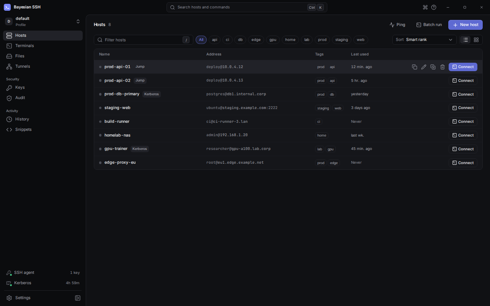
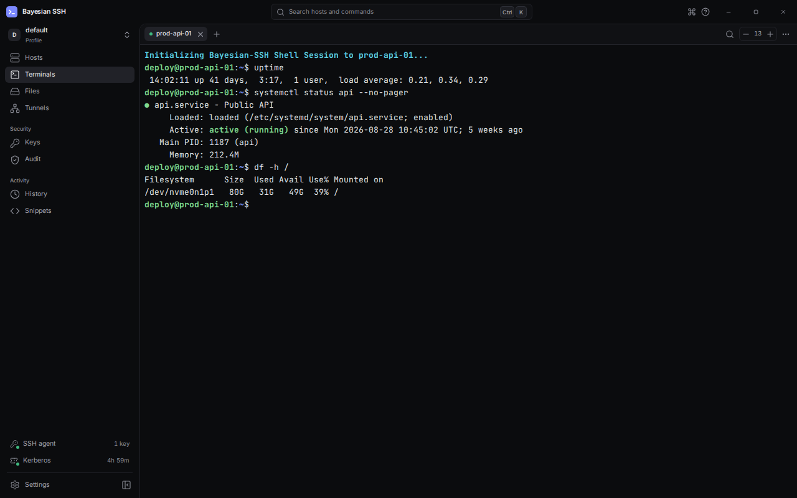
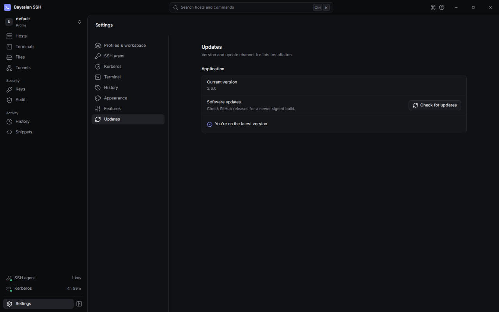

# Desktop GUI Mode

Bayesian SSH ships a standalone desktop app: a SvelteKit/TypeScript front end on a
Rust/Tauri backend. It manages the same hosts, profiles and session history as the
CLI, and adds terminals, a file browser, tunnel rules and a local security check.

## Launching

```bash
bssh desktop
bayesian-ssh desktop
```

`desktop` (alias `gui`) starts the GUI detached in the background and returns the
prompt immediately. The launcher looks for the `bayesian-ssh-gui` binary next to the
CLI executable, then in `PATH`.

Packaged installs start the same `bayesian-ssh-gui` binary:

- the `.deb`, `.rpm` and AppImage bundles are built under the `bayesian-ssh-desktop`
  product name; the `.deb` and `.rpm` add an entry to the application menu;
- in the snap, the `bayesian-ssh.gui` app runs the desktop binary and is also
  available from the app menu.

The first launch runs onboarding, which starts by asking which applies:

- **Set up this machine** — profile name and connection defaults, an optional
  OpenSSH import, the theme, an optional restore from a backup file, and a last
  step to add or import a first host and connect to it.
- **I was invited to a team** — paste the invite message your admin sent, choose
  the passphrase that protects this device's Teams keys, and join. The app then
  shows this device's fingerprint to send back to your admin, who grants the key
  after checking it. See [Teams](./teams.md).

## Window layout

- **Title bar** — app name, a **Jump to…** button (`Ctrl`/`Cmd` + `K`) that opens the command palette, a keyboard-shortcuts button, an About button and the window
  controls. The bar is draggable.
- **Sidebar** — a profile switcher at the top, grouped navigation, status entries at
  the bottom, and a collapse toggle.
- **Main area** — the active view, each with a single header holding its title and
  one primary action.

Sidebar navigation:

- **Hosts**, **Terminals**, **Files**, **Tunnels** (Files and Tunnels appear only
  when they are enabled under Settings → Terminal & files)
- **Security**: Keys, Security check
- **Activity**: History
- **Team**: Teams
- At the bottom: **Background** (only while sessions run outside the tab bar), the
  **SSH agent** entry (state plus loaded-key count; click to start the agent or open
  its manager), the **Kerberos** entry, and **Settings**. The Kerberos entry stays
  hidden until a connection actually uses Kerberos.

Each entry shows its number key (`1`–`8`, in sidebar order). The sidebar collapses
to icons automatically when the window is narrower than 1100 px; the collapse toggle
still works.

## Views

### Hosts



The host list is the main view. It has a filter box, tag chips, a sort selector and a
list/grid toggle. Tag chips that don't fit the window go behind a `+N` button that
lists the rest; when the selected tag is one of them, the button shows its name.

- **Sort** — Smart rank (frequency and recency), Last used, Name or Address.
- **List view** — columns Name, Address, Tags, Source and Last used. Address is
  shown as `user@host`, with `:port` when it is not 22. Hosts with Kerberos or a
  jump host carry a badge. Narrow windows show the first tag and a `+N` button that
  lists the others. Row height follows the density setting (Settings → Appearance).
- **Source** — where a host comes from: Local, an inventory source, or a team
  (people icon and the team name). The column and the source chips above the list
  (All, Local, each team and source, with counts) appear once any host comes from a
  source.
- **Grid view** — the same information as cards, mounted progressively while you
  scroll. The list is windowed, so large host lists stay responsive.
- **Ping** — checks reachability for every host, then reports `n/m up` and shows a
  latency next to each reachable host.
- **Batch run** — opens the batch-execution modal (see below).
- **New host** — opens the host form.

Row actions (also on cards) appear on hover, focus or selection: **Connect**,
**Files**, and a **More** menu with **Copy SSH command**, **Edit**, **Duplicate**,
**Share with a team…** and **Delete…**. Duplicate creates `<name> (Copy)`, flashes
the new row and opens it for editing. Delete asks for confirmation and shows
`user@host:port`.

**Share with a team…** shares the host's address, user, port, jump host, Kerberos
setting and tags (never key paths or passwords) with a team this device holds the
key for; everyone in the team gets it at their next sync. On a team copy the action
reads **Update in** *team*. If Teams isn't set up or is locked, the dialog says so
and offers **Open Teams**. CLI: `bssh teams share <host> --team <team>`.

The list is a single Tab stop. With a host selected: `↑`/`↓` or `j`/`k` move,
`Enter` connects (or switches to the session already open to that host),
`Shift` + `Enter` always opens a new tab, `Ctrl`/`Cmd` + `Enter`
opens it in Files, `C` copies the ssh command, `E` edits, `S` shares with a team and
`Delete` deletes. `←`/`→` reach the row's buttons. With no hosts yet, the empty
state offers **Import ~/.ssh/config** and **New host**.

The host form (`New host` / `Edit host`) collects Name, Host, Port, User and an
identity file, plus a Kerberos switch, comma-separated tags and an **Advanced**
section for a jump host and jump user. Changes apply to new sessions; saved hosts are
written to the active profile.

### Terminals



Terminals open as tabs over xterm.js sessions backed by Rust PTY processes. The empty
state lists your recent hosts to connect with, and the **+** button opens a host
launcher with a `Connect to host…` filter.

Each tab shows a status dot (Connected, Connecting, Failed to connect, Disconnected)
and a close button; middle-clicking a tab closes it.

While ssh starts, the tab shows "Connecting to user@host…" (with "via" and the jump host
when there is one) and the elapsed time; `Esc` or **Cancel** stops it. If ssh fails
to connect, the tab stays open with the error in plain words, **Retry**, **Edit
host** and the equivalent `bssh connect` command.

`Ctrl` + `Tab` / `Ctrl` + `Shift` + `Tab` switch tabs, `Ctrl` + `Shift` + `W` closes
one and `Ctrl` + `Shift` + `T` reopens the last closed host (`Cmd` + `W` / `T` on
macOS). With an active session:

- **Find** (`Ctrl`/`Cmd` + `F`) opens a per-tab search bar over the scrollback
  (`Enter` next match, `Shift` + `Enter` previous).
- **Font size** buttons adjust the terminal text; `Ctrl`/`Cmd` + mouse wheel zooms,
  `Ctrl` + `Shift` + `=`/`-`/`0` (`Cmd` + `=`/`-`/`0` on macOS) adjust or reset it
  while the terminal is focused, and `Ctrl`/`Cmd` + `+`/`-`/`0` when it isn't. The
  value is remembered in settings.
- **More** offers Open in new window, Run in background, Export scrollback (to a
  `.txt` file), Clear screen, Manage sessions…, and Close all sessions.

Sessions can live in three places: a tab, a pop-out window, or the background.
Dragging a tab away from the tab strip opens it in its own window; dragging a pop-out
or background session back onto the tab bar docks or reattaches it with its buffered
output. The **Running sessions** manager lists everything outside the tab bar and can
focus, dock, reattach or terminate each session, or terminate all of them.

Closing the window while sessions are open shows a confirmation with **Cancel**,
**Minimize to tray** (keeps the sessions running) and **Disconnect and quit**. With no
open sessions the window simply hides to the tray.

Plain `Ctrl` + `C`/`V`/`F` always go to the shell. Copy, paste and find are
`Ctrl` + `Shift` + `C`/`V`/`F` (`Cmd` + `C`/`V`/`F` on macOS), or `Shift` + `Insert`
to paste; **Smart copy** (Settings → Terminal & files) makes `Ctrl` + `C` copy when
text is selected. OSC 52 clipboard writes from remote hosts are honoured; reads are
refused.

### Files

The Files view browses a remote directory over SFTP. Pick a host (opening Files
from a host's **Files** action, `Ctrl`/`Cmd` + `Enter` or the palette selects it for
you) and press **Connect**; the header then shows `user@host` and the button becomes **Disconnect**.

- Breadcrumbs navigate the tree; a go-to button turns the path into an editable field
  (`Enter` loads, `Esc` cancels).
- **Parent directory** and **Refresh** buttons sit in the toolbar, next to quick
  bookmarks for `/`, `~`, `/var/www`, `/etc`, `/var/log` and `/tmp`.
- The filter matches a file name or its permissions, and a **Hidden files** toggle
  shows or hides dotfiles (with a count of what is hidden).
- List and grid layouts are available; each entry shows its type icon, size,
  permissions and modification time, and its remote path can be copied.

The browser is read-only for its own navigation: it lists directories and reports
errors. The desktop app can also upload a file to several hosts at once.

### Tunnels

The Tunnels view manages port-forwarding rules: local (`-L`), remote (`-R`) and
SOCKS5 dynamic (`-D`). You can start from a preset or add a rule with a host, type,
local port, remote host and remote port; the form validates the values and previews
the matching `ssh` command. Each rule can be enabled or disabled, edited, deleted, or
have its local address copied.

Rules are configuration held by the view: no tunnel process is started, and rules are
not persisted across restarts. The section is hidden when Tunnels is turned off under
Settings → Terminal & files.

### Keys

The Keys view lists the identity files in `~/.ssh`, paired from each `*.pub` file:

- columns **Key** (name, comment and shortened path), **Type**, **Fingerprint**
  (copyable) and **Permissions**;
- a green permissions badge means the private key is only readable by you; a red
  badge means group/other bits are set, and an alert at the top gives a copyable
  `chmod 600` command for every affected key;
- **Generate key** creates a new pair in `~/.ssh` (Ed25519, or RSA for older servers)
  with an empty passphrase;
- **Deploy** copies a public key to a chosen host's `authorized_keys`.

### Security check

The Security check view (the local scan; **Audit log** is reserved for Teams) runs on open and scores the local setup out of 100 with a grade, plus
counts for Critical, Warnings and Info findings. A severity filter narrows the list.
Each finding shows its description and a copyable remediation command.

The checks cover StrictHostKeyChecking being disabled, overly permissive permissions
on the config directory and database file, private keys readable by other users,
connections with no identity key and no Kerberos, and connections unused for more than
90 days. **Fix permissions** tightens the config directory, database file, `~/.ssh`
and key files that are group/other-accessible, then re-runs the check. **Re-scan**
re-runs it manually.

### History

Session history is grouped by day (Today, Yesterday, then dates) and shows Host,
Started (relative, with an absolute tooltip in the configured timezone), Duration,
Status and Exit code. Rows are badged **Succeeded**, **Failed** or **Running**; the
status chips (`All`, `Succeeded`, `Failed`) and the search box filter the table.
Once a host comes from an inventory source or a team, a **Source** column and source
chips appear too; team admins get **View in** *team* **audit log** on team sessions,
which opens that team's Audit log tab. **Export CSV** downloads every recorded
session.

### Settings

Settings (`Ctrl`/`Cmd` + `,`) has six sections, also reachable from the command
palette ("Settings: Terminal & files"). Every control saves immediately; there is no
Save button.

- **Workspace** — switch or manage profiles, choose how hosts are ranked
  (usage-ranked Bayesian scoring or fuzzy matching), set the OpenSSH config file used
  for imports, import hosts, encrypt/export/restore backups, and see the config,
  profile and database paths.
- **Connection** — the default user and port used by hosts that don't define their
  own, the SSH agent (start on launch, custom socket), and Kerberos ticket monitoring
  with its warning threshold.
- **Terminal & files** — font family, size and line height, cursor style and
  blinking, scrollback size, copy-on-select and Smart copy, whether the file browser
  lists dotfiles, and the switches that turn Files and Tunnels on or off (the
  sidebar updates immediately).
- **Privacy & history** — record session history, cap the number of stored entries,
  the backend log level, and session recording (all hosts or only hosts with given
  tags).
- **Appearance** — theme, row density and the timezone used for dates in history,
  logs and audit. Themes: **Graphite**, **Midnight**, **OLED black**, **Paper** (light)
  and **Match system** (Paper or Graphite, following the system's light/dark setting
  as it changes). Density sets list and table rows to 32, 40 or 48 px (Compact,
  Comfortable, Spacious). A previously saved Slate theme opens as Midnight.
- **Sources & updates** — inventory sources (see
  [Inventory sources](./inventory-sources.md)), and the current version and updates
  for the way the app was installed.

  

  In-app updates apply to the AppImage and to the `bayesian-ssh-desktop` `.deb`/`.rpm`
  from GitHub releases: **Check for updates** reports a newer signed build, and
  **Install and restart** downloads, verifies and installs it. Open terminal sessions
  are closed and the app restarts. Snap installs are updated by the Snap Store (the
  section shows `sudo snap refresh bayesian-ssh`), and other installs (raw binaries
  from `install.sh` or release tarballs, the unified CLI+GUI packages, and source
  builds) are updated the way they were installed.

## Modals and dialogs

- **Command palette** (`Ctrl`/`Cmd` + `K`; `Ctrl` + `Shift` + `P` from a focused
  terminal) — searches hosts and commands. It groups results into Hosts, Actions,
  Teams, Navigation, Settings and Themes; with an empty query it shows the first
  hosts plus the actions and navigation entries.
  - A highlighted host lists its verbs (Connect, Connect in new tab, Browse files,
    Copy ssh command, Edit) with their keys and CLI equivalents; `Enter` connects,
    `Ctrl`/`Cmd` + `Enter` opens Files.
  - Actions cover New host, Run command on hosts, Ping all hosts, Manage sessions and
    Fix key permissions.
  - Teams entries depend on the state: Unlock Teams…, Sync all teams, Lock Teams,
    Review waiting devices in *team* and Invite to *team*… (admins). They open the
    team; granting a key always happens in the team page after checking the
    fingerprint, never from the palette.
  - Navigation entries jump to a view, Settings entries open a section, theme
    entries switch the theme.
- **Batch run** — runs one command on several hosts in parallel. Pick hosts (with
  filter, tag chips and All/None/Invert/Prod/Non-prod shortcuts), enter a command,
  optionally save it as a template, choose dry run and a timeout, then preview or run.
  Results list each host with its exit code, duration and stdout/stderr, and can be
  exported as Markdown, CSV, JSON or plain text. A History tab keeps recent runs (for
  inspection or repeat) and a Templates tab manages built-in and custom commands.
  `Ctrl`/`Cmd` + `Enter` runs, `Ctrl`/`Cmd` + `Shift` + `D` toggles dry run.
- **Profiles** — list profiles, create a new one, and delete any profile that is
  neither active nor the default. Switching profiles happens from the sidebar profile
  menu, which also opens this dialog through **Manage profiles…**.
- **SSH agent** — shows the agent socket and the loaded keys with their fingerprints,
  and adds a private key file to the agent.
- **Kerberos** — shows ticket status (principal, realm, remaining lifetime, renew
  time, cache and config paths) and acquires a ticket with `kinit`, or renews the
  existing one (`kinit -R`, with an optional password). Ticket options cover
  forwardable, proxiable, lifetime and renewal lifetime.
- **About** — version, active profile, config and database paths, license, and links to
  the source code, release notes and issue tracker.
- **Confirmations** — host deletion, all-session close, and quitting with open sessions
  all use in-app dialogs instead of native prompts.

## Keyboard shortcuts

Press `?`, `F1` or `Ctrl`/`Cmd` + `/` to open the shortcut sheet; it, the sidebar
hints and the command palette all come from one table, so they always agree.
Single-key shortcuts work when no text field, dialog or terminal is focused. On macOS
read `Cmd` for `Ctrl`, and `Cmd` alone for `Ctrl` + `Shift` in terminals.

| Action | Keys |
| --- | --- |
| Command palette | `Ctrl`/`Cmd` + `K` (`Ctrl` + `Shift` + `P` in a terminal) |
| Settings | `Ctrl`/`Cmd` + `,` |
| Keyboard shortcuts | `?`, `F1`, `Ctrl`/`Cmd` + `/` |
| Close a dialog or clear the filter | `Esc` |
| Hosts / Terminals / Files / Tunnels / Keys / Security check / History / Teams | `1` … `8` (sidebar order) |
| Focus the host filter | `/` |
| New host | `N`, `Ctrl`/`Cmd` + `N` |
| Move host selection | `↑`/`↓`, `j`/`k` |
| Connect to the selected host (or switch to its open session) | `Enter` |
| Connect in a new tab | `Shift` + `Enter` |
| Open the selected host in Files | `Ctrl`/`Cmd` + `Enter` |
| Copy its ssh command / edit / share / delete | `C` / `E` / `S` / `Delete` |
| Next / previous terminal tab | `Ctrl` + `Tab` / `Ctrl` + `Shift` + `Tab` |
| Close / reopen a terminal tab | `Ctrl` + `Shift` + `W` / `Ctrl` + `Shift` + `T` |
| Terminal copy / paste / find | `Ctrl` + `Shift` + `C` / `V` / `F` |
| Terminal font size | `Ctrl` + `Shift` + `=` / `-` / `0` |
| Cancel a connection in progress | `Esc` |
